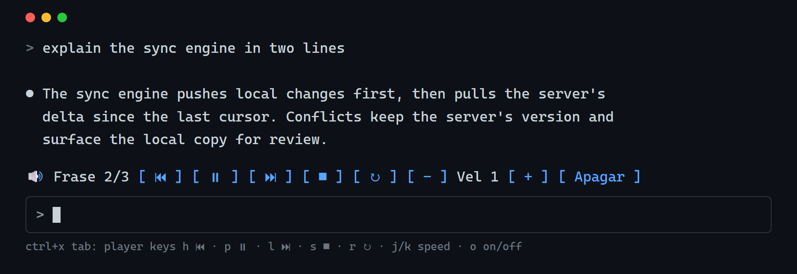

# voice-player

**Hear Claude's answers. Fully offline, on your own machine.**

A Claude Code mod that reads every answer aloud with the voices already built into Windows, plus a small player above the prompt: pause, skip sentences, repeat, change speed. No API keys, no cloud speech, no accounts. Windows only. It prefers an installed Spanish voice and otherwise uses the default Windows voice.



## Requirements

- Windows 10/11
- [.NET 10 SDK](https://dotnet.microsoft.com/download/dotnet/10.0)

## Install

```
/plugin install voice-player --marketplace sirlens/voice-player
```

## Use

Buttons: click, or `ctrl+x tab` then the key.

| Key | Action |
|---|---|
| `h` / `l` | Previous / next sentence |
| `p` | Pause / resume |
| `s` | Stop |
| `r` | Repeat last answer |
| `j` / `k` | Slower / faster |
| `o` | On / off |

Command: `/voice-player pause | resume | stop | next | prev | again [n] | rate <-10..10> | on | off | status | log`

## What it runs

- **First run only:** `dotnet build` compiles the bundled speech server (`server/`), which downloads the `System.Speech` package from NuGet once. After that, nothing goes online.
- **Each session (while voice is on):** starts `voice-player-server.exe`, listening only on `localhost` with a random port and a random token. It exits when Claude Code exits.
- **Each answer:** sends the answer's text (code blocks replaced by a short spoken note, links reduced to their label, URLs spoken as "enlace", paths reduced to their last segment, Markdown marks removed; cut at 20,000 characters) to that local server, which speaks it with Windows' speech engine (SAPI). Text never leaves your machine.
- **Log:** last 200 lines in `voice.log` in the plugin's data folder (`/voice-player log` shows the last 15). It records events and text lengths, not the answers.

## License

MIT
